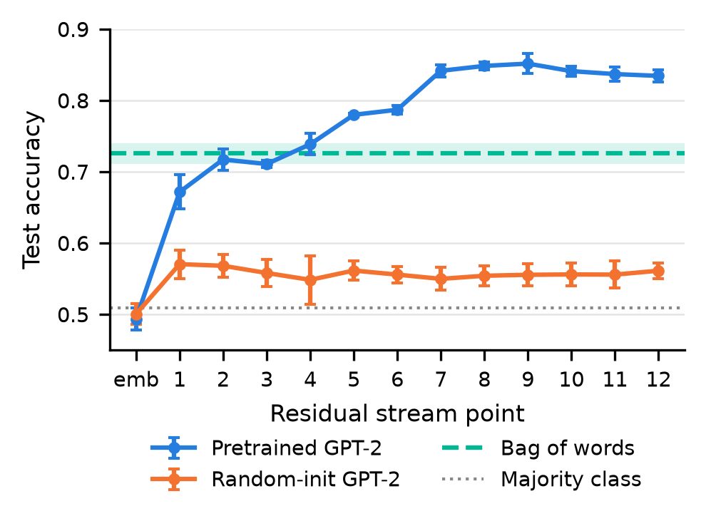
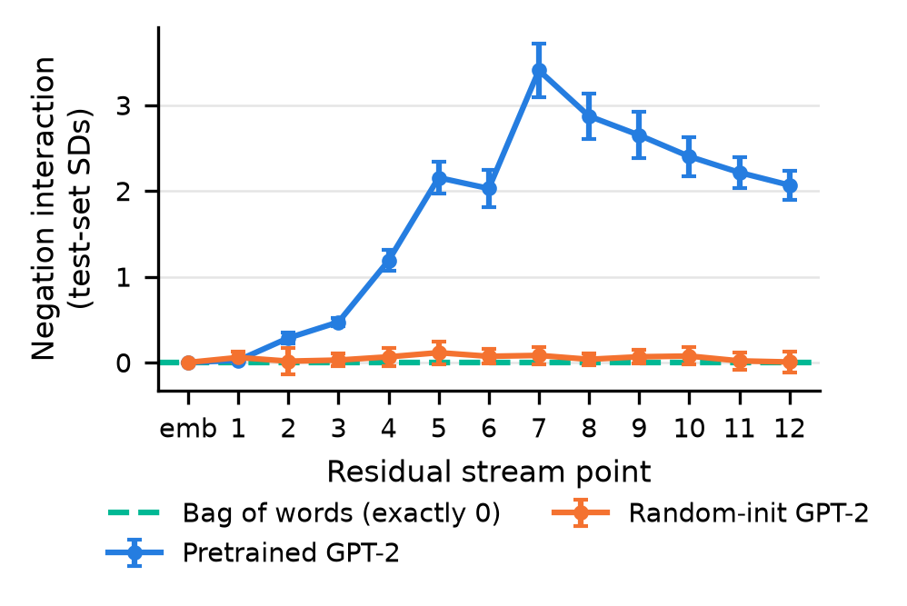

# Sentiment probes in GPT-2 small

After which block of GPT-2 small can a simple linear classifier tell whether a movie review is positive or negative?

I recorded GPT-2 small's internal numbers for the last word of each SST-2 sentence at 13 points (before any block, then after each of the 12 blocks) and trained a logistic regression probe at each point. Every probe is compared with a word-counting classifier, an untrained copy of GPT-2, a shuffled-label probe and a majority-class guess. Everything is repeated five times with separate training data, and differences are checked with paired bootstrap tests.



## Results

- Sentiment is readable after the first block (67.2%) and clearest after blocks 7 to 9 (84 to 85%). The last two blocks are slightly lower.
- Word counting gets 72.5%. GPT-2 is worse after block 1, level at block 4 and clearly better from block 5 on (+11.6 points at block 7).
- An untrained GPT-2 stays around 55 to 57% at every block. The trained model is up to 30 points better.
- Training only on full-stop sentences, like the test set, matches the main result with under a third of the data, so the gap between training and test sentences makes the main numbers slightly conservative.
- Negation: early blocks treat "not" as a negative word, the same as word counting. From block 7, "not good" reads as negative and "not bad" as less negative, which no word-counting model can do.



A probe shows that information can be read from the model. It doesn't show that GPT-2 uses it. The paper and `notes.md` list the other limits.

## Setup

Runs on a CPU. I used Windows 11, Python 3.13.3 and 8 GB RAM.

```bash
python -m venv .venv
.venv\Scripts\Activate.ps1          # macOS/Linux: source .venv/bin/activate
pip install torch==2.15.0 --index-url https://download.pytorch.org/whl/cpu
pip install -r requirements.txt
```

## Running it

Run the scripts in `scripts/` in number order, from the repo root. The whole thing takes about an hour on a laptop CPU. The slowest one is `10_extract_resamples.py` (about 22 minutes).

| scripts | what they do |
|---|---|
| 00 to 02 | check setup, look at hidden states, build the data |
| 03 to 06 | extract hidden states, train probes, run controls |
| 07 to 08 | untrained GPT-2 control |
| 09 to 12 | five runs and paired comparisons |
| 13 | full-stop training control |
| 14 | negation pairs |
| 15 | check that the shared code reproduces saved results |
| 16 | paper figures and table |

`data/` isn't committed because the arrays are large. The scripts recreate it, and every run is seeded, so you get the same numbers.

## Files

```
scripts/    experiment scripts, plus probe_utils.py and extract_utils.py
results/    CSV files with every reported number
figures/    plots
paper/      LaTeX source of the write-up
notes.md    research log
```

## Data and tools

- SST-2: Socher et al. (2013), Recursive Deep Models for Semantic Compositionality Over a Sentiment Treebank, EMNLP. Loaded from Hugging Face (`stanfordnlp/sst2`).
- GPT-2: Radford et al. (2019), Language Models are Unsupervised Multitask Learners.
- TransformerLens: https://github.com/TransformerLensOrg/TransformerLens
